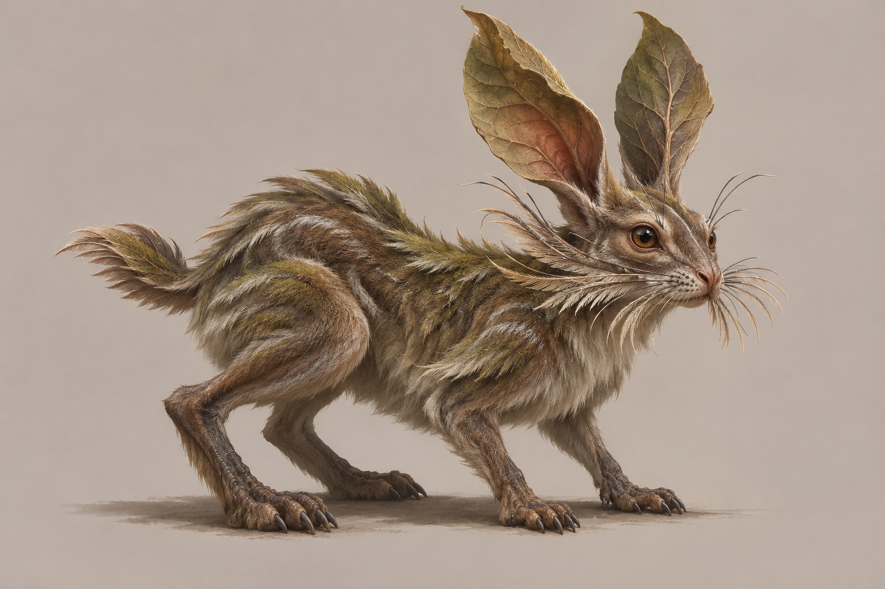
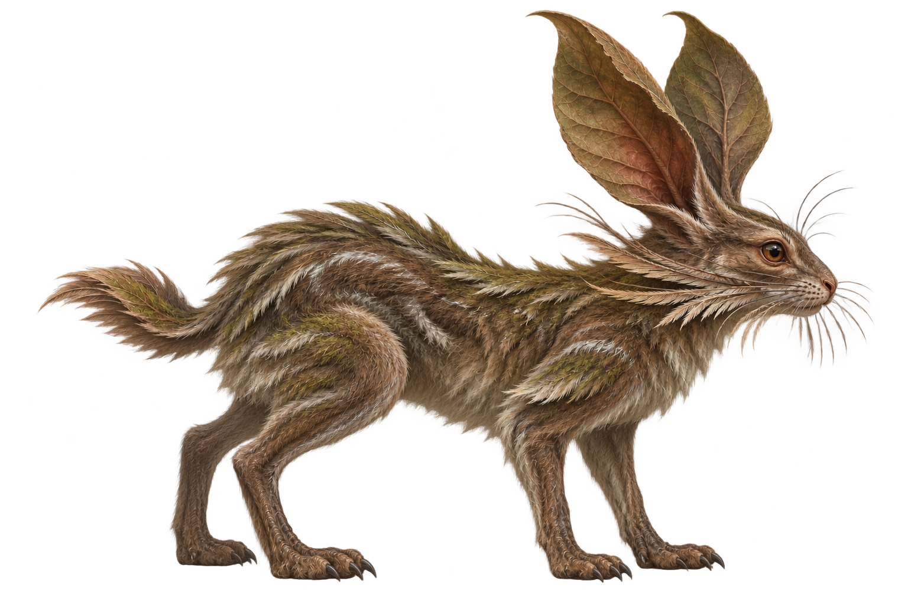

# Fısıltı Tavşanı

**Görsel:** Orijinal kaynak bu arşivde mevcut.

**Rol:** Küçük otçul · **Habitat:** Orman zemini

## Anatomik fikir
Yaprak damarlı döner kulaklar, titreşim algılayan yanak yelpazeleri ve yana sıçramaya uygun güçlü arka bacaklar.

## Nasıl tasarlandı? · Öğretici notlar
1. **Ekolojik görev:** orman zemini için hangi hareket ve beslenme sisteminin gerektiğini belirle.
2. **Silüet:** Eşsiz anatomik özelliği detaydan önce dış hatla okunabilir kıl.
3. **Anatomik denetim:** Bacakları, eklemleri, gövde ağırlığını ve organların bağlanma yerlerini kontrol et.
4. **Doku ve renk:** Biyolojik olarak bağlı materyal kullan; yalnız süs amacıyla takılmış parçalardan kaçın.
5. **Rig/oyun varlığı hazırlığı:** Duyusal organların tasarımını silüetten okut; her kulağı, kuyruğu ve dört bacağı rigde ayrı kontrol et.
6. **Kabul kontrolü:** Bütün uzuvlar görünür, form küçük oyun ölçeğinde tanınabilir ve hayvanın ekolojik işlevi anlaşılır olmalı.

## Kullanım notu
Bu sayfa konsept tasarım yöntemini açıklar; gerçek hayatta var olan bir tür veya doğrulanmış evrimsel model iddiası taşımaz.

## 2D rigging yan profil referansı

