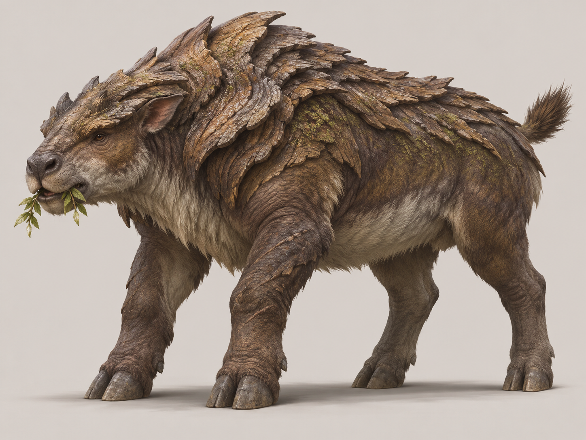

# Kabuk Sırtı

**Görsel:** Orijinal kaynak bu arşivde mevcut.

**Rol:** Orta otçul · **Habitat:** Dere kenarı

## Anatomik fikir
Üst sırtı organik kabuk katmanlarıyla korunan, çalıları yarıp ilerleyen, alçak ağırlık merkezli otçul.

## Nasıl tasarlandı? · Öğretici notlar
1. **Ekolojik görev:** dere kenarı için hangi hareket ve beslenme sisteminin gerektiğini belirle.
2. **Silüet:** Eşsiz anatomik özelliği detaydan önce dış hatla okunabilir kıl.
3. **Anatomik denetim:** Bacakları, eklemleri, gövde ağırlığını ve organların bağlanma yerlerini kontrol et.
4. **Doku ve renk:** Biyolojik olarak bağlı materyal kullan; yalnız süs amacıyla takılmış parçalardan kaçın.
5. **Rig/oyun varlığı hazırlığı:** Zırhı kemik/keratin kökenli göster; plakalar arası esnek dikişler ve çamur tutan geniş toynaklar oluştur.
6. **Kabul kontrolü:** Bütün uzuvlar görünür, form küçük oyun ölçeğinde tanınabilir ve hayvanın ekolojik işlevi anlaşılır olmalı.

## Kullanım notu
Bu sayfa konsept tasarım yöntemini açıklar; gerçek hayatta var olan bir tür veya doğrulanmış evrimsel model iddiası taşımaz.
