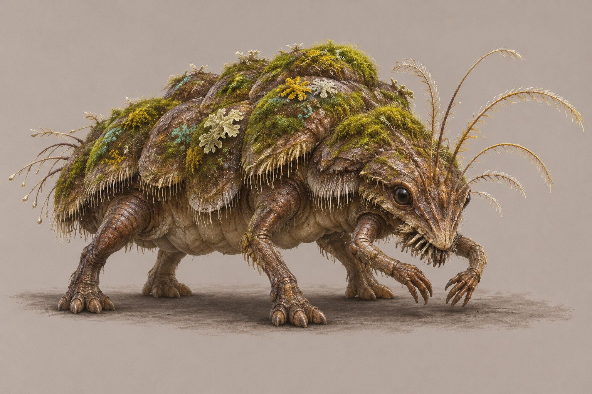

# Yosun Gezginciği

**Görsel:** Tam vücut konsept referansı arşive eklendi.

**Rol:** Küçük otçul · **Habitat:** Nemli orman zemini

## Anatomik fikir
Yosun yastıklarını taklit eden keratin kabarcıklı, dört yürüyüş ve iki beslenme uzvu olan küçük tarayıcı.

## Nasıl tasarlandı? · Öğretici notlar
1. **Ekolojik görev:** nemli orman zemini için hangi hareket ve beslenme sisteminin gerektiğini belirle.
2. **Silüet:** Eşsiz anatomik özelliği detaydan önce dış hatla okunabilir kıl.
3. **Anatomik denetim:** Bacakları, eklemleri, gövde ağırlığını ve organların bağlanma yerlerini kontrol et.
4. **Doku ve renk:** Biyolojik olarak bağlı materyal kullan; yalnız süs amacıyla takılmış parçalardan kaçın.
5. **Rig/oyun varlığı hazırlığı:** Dört ana yürüme uzvu ile iki ağız manipülatörünü işlevsel olarak ayır; gerçek yosun yapıştırması gibi görünmesin.
6. **Kabul kontrolü:** Bütün uzuvlar görünür, form küçük oyun ölçeğinde tanınabilir ve hayvanın ekolojik işlevi anlaşılır olmalı.

## Kullanım notu
Bu sayfa konsept tasarım yöntemini açıklar; gerçek hayatta var olan bir tür veya doğrulanmış evrimsel model iddiası taşımaz.
